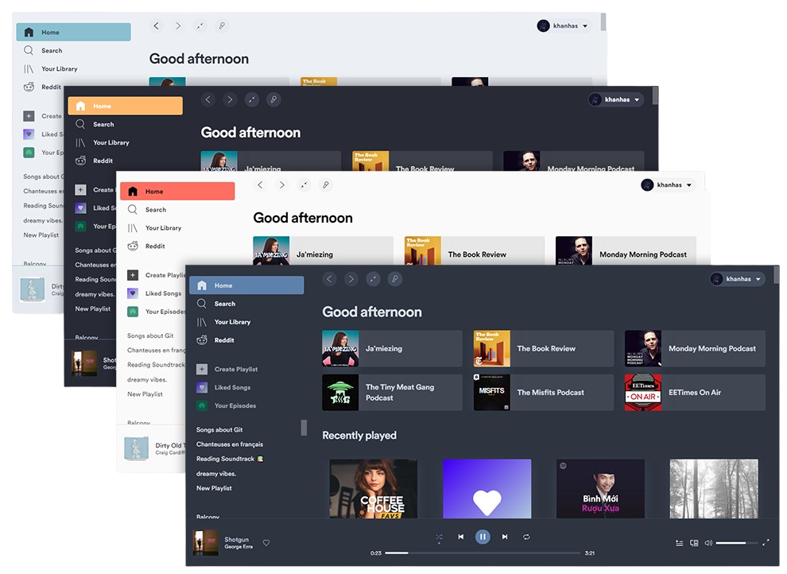
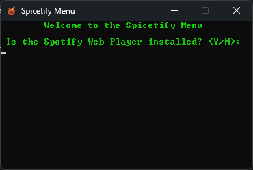
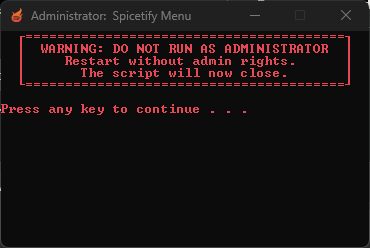

  

# 🎵 Spicetify Menu

I created this Windows utility to automate the installation, update, and
removal of Spicetify. It uses the official Spicetify installer links so the
user does not need to type a long sequence of commands in Command Prompt.

> **Author:** I created and maintain the original code in this project.

## ✅ Requirements

- 🪟 Windows 10 or Windows 11
- 🎵 Spotify desktop application
- 📦 The `.exe` downloaded from this repository's Releases
- 🚫 Do not run the program as Administrator

This utility is intended for the Spotify desktop application, not the web
player or the Microsoft Store version.

## 📥 Downloads

- [Download the latest Spicetify Menu release](../../releases/latest)
- [Download Spotify directly from the official installer](https://download.scdn.co/SpotifySetup.exe)

The executable is distributed through GitHub Releases. Download it only from
this repository's Releases page.

## 🚀 Tutorial

### 1️⃣ Install Spotify

Install the Spotify desktop application using the
[official Spotify installer](https://download.scdn.co/SpotifySetup.exe).
Open Spotify once after installation, then close it before starting Spicetify
Menu.

### 2️⃣ Download the Spicetify Menu executable

1. Open the [latest release](../../releases/latest).
2. Download the `.exe` asset.
3. Save it in a normal folder such as `Downloads\Spicetify`.
4. Double-click the executable to start it.

The program checks that Spotify is available before showing the menu. Follow
the prompt shown in the console window.

### 3️⃣ Do not run as Administrator

Run the program normally. If Windows shows **Administrator** in the window
title, close it and start the executable again without elevation.

The program stops intentionally when it detects an elevated console.

### 4️⃣ Choose an operation

After the initial check, the main menu provides:

| Option | Action |
| --- | --- |
| `1` | Install Spicetify and the Marketplace |
| `2` | Update Spicetify and reapply the backup |
| `3` | Restore Spotify and remove Spicetify files |
| `0` | Exit |

Select an option in the console and follow the progress messages. The utility
automates the official installation commands and the required Spicetify
backup, apply, restore, clear, and restart steps.

### 5️⃣ Confirm the result

After installation, confirm whether the operation worked:

- Choose **Y** to return to the menu.
- Choose **N** to restore Spotify and retry the installation.

The uninstall option asks for confirmation before removing Spicetify data from
`%APPDATA%\spicetify` and `%LOCALAPPDATA%\spicetify`.

## 🔗 Official tools used

The utility automates these official Spicetify links:

- [Spicetify CLI installer](https://raw.githubusercontent.com/spicetify/spicetify-cli/master/install.ps1)
- [Spicetify Marketplace installer](https://raw.githubusercontent.com/spicetify/spicetify-marketplace/main/resources/install.ps1)

No third-party download mirror is required for Spicetify installation.

## 🧪 Last tested version

The repository checks the latest release in the official
[Spicetify CLI repository](https://github.com/spicetify/spicetify-cli) every
15 minutes. The version below is updated automatically in this README when a
new CLI release is published.

This synchronization changes documentation only. The released `.exe` is not
replaced because the program already uses the official Spicetify CLI.

<!-- SPICETIFY_VERSION:START -->
- ✅ Spicetify `v2.46.7`
<!-- SPICETIFY_VERSION:END -->

The original Gist was tested on 20 May 2025 with Spotify
`1.2.62.580.gb27ad23e` and Spicetify `v2.40.9`.

## 📄 License

All rights reserved. See [LICENSE](LICENSE).
